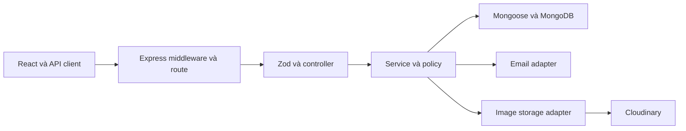

# Kiến trúc Recipe Hub

Đọc khi cần xác định một hành vi thuộc UI, HTTP contract, service hay persistence. [ADR](adr/) ghi các quyết định và giới hạn tại từng mốc.

## Ranh giới

- **Monorepo.** [package.json](../package.json) quản lý workspaces backend và frontend. [CI](../.github/workflows/ci.yml) sử dụng MongoDB test riêng và chạy kiểm tra cả hai phía.
- **Frontend.** [App](../frontend/src/App.js) dựng shell, session và màn theo [registry](../frontend/src/app/registry.js). [Router](../frontend/src/app/router.js) xử lý URL, history và guard. [Các feature](../frontend/src/features/) giữ giao diện và quy tắc tương tác theo miền. [Primitives](../frontend/src/components/ui/primitives.js) và [kitchen components](../frontend/src/components/kitchen/) chia sẻ UI. [API client](../frontend/src/services/api.js) chuẩn hóa lỗi, lấy CSRF và hủy request đọc khi phù hợp.
- **Backend.** [server.js](../backend/src/server.js) nạp cấu hình, kết nối MongoDB và lắp factories. [app.js](../backend/src/app.js) thiết lập request ID, headers, JSON parser, kiểm tra CSRF và router. Route chuyển input qua validator, controller gọi service và chuyển kết quả thành DTO. Service giữ policy, filter, CAS và orchestration. Mongoose lưu document và index. [Các module](../backend/src/modules/) chia theo danh tính, catalog, recipe, media và tương tác xã hội.
- **Tích hợp.** [Email provider](../backend/src/integrations/email-provider.js) gửi qua SMTP khi được bật. [Storage adapter](../backend/src/integrations/image-storage/) bọc Cloudinary hoặc fake. Gateway dùng adapter đọc bytes phía server và kiểm tra quyền mỗi lần xem.

Trong development, Vite proxy `/api` về backend để trình duyệt dùng cùng origin. [OpenAPI](../backend/src/openapi/openapi.yaml) là contract cho client. [Hướng dẫn API](API.md) giải thích trường hợp cần cookie, CSRF, version và idempotency.

## Luồng quan trọng

1. **Xác thực.** Browser lấy CSRF, gửi login, nhận cookie phiên HttpOnly và lấy lại CSRF khi phiên đổi. Backend kiểm tra phiên, trạng thái và `authVersion` trên mỗi request cần danh tính. UI đọc phiên từ `/auth/me`, dùng revision cho dữ liệu private và xử lý mất phiên. [Bảo mật](SECURITY.md)
2. **Công thức.** Chủ sở hữu tạo hoặc sửa bản nháp bằng CAS. Publish kiểm tra dữ liệu và catalog trước CAS. Khi đọc công khai, [visibility pipeline](../backend/src/modules/recipes/recipe-visibility.js) áp trạng thái món và kiểm tra tác giả active. Search, danh sách theo tác giả, Favorites, Bookmarks và tương tác dùng chung policy trước khi đếm hoặc phân trang. [ADR 007](adr/007-recipe-draft-and-media-integration.md) · [ADR 008](adr/008-recipe-publication-and-media-visibility.md) · [ADR 009](adr/009-recipe-search-filtering-and-favorites.md)
3. **Media.** Upload cấp một asset tạm. Save gắn tham chiếu vào công thức hoặc hồ sơ. Gateway đọc ảnh theo tham chiếu hiện tại. Worker xử lý intent và thu hồi ảnh đủ điều kiện. [Media lifecycle](MEDIA.md)
4. **Recovery.** Hệ thống hỗ trợ MongoDB standalone. Với thao tác liên collection, service lưu intent bền vững, dùng CAS trên document canonical, chặn tranh chấp bằng fence rồi đối soát các bước phụ. API chỉ trả thành công theo xác nhận của từng contract. [ADR 006](adr/006-media-lifecycle-and-reconciliation.md) · [ADR 010](adr/010-social-interactions-and-moderation.md)

[DATABASE.md](DATABASE.md) tra collection và index. [ROADMAP.md](ROADMAP.md) theo dõi phần danh sách chủ sở hữu, giao diện cộng đồng và các hợp đồng chưa có.

Recipe đã xuất bản là bài viết cộng đồng. Hai collection độc lập ghi nhận lượt thích và món đã lưu. MongoDB lấy trang theo visibility, rồi tính số bình luận và lượt thích cho các ID thuộc trang. Frontend lấy trạng thái cá nhân qua một truy vấn batch.

Editor dựng preview từ state cục bộ bằng hai component trình bày của bài viết và trang món. Khi tác giả cập nhật món đang đăng, service dựng toàn bộ nội dung đề xuất, kiểm tra publication, catalog và media rồi ghi một lần bằng CAS trên Recipe. Các quan hệ theo recipeId và ngày xuất bản đầu tiên được giữ nguyên.
