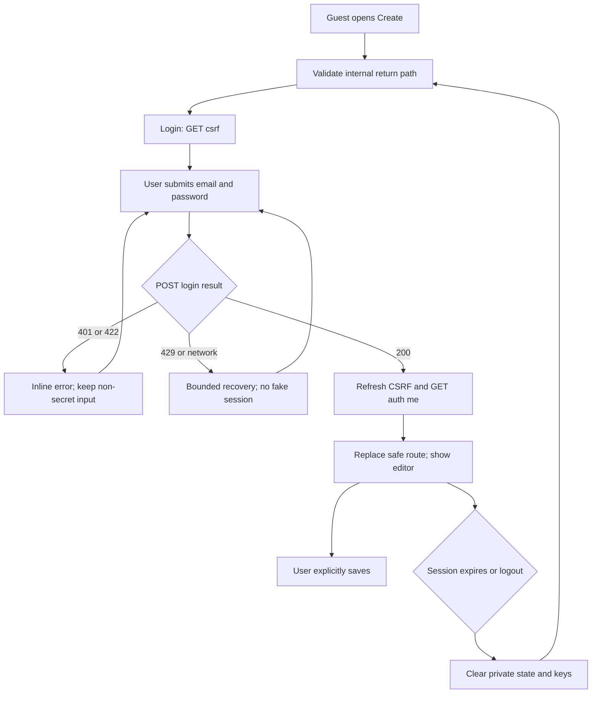
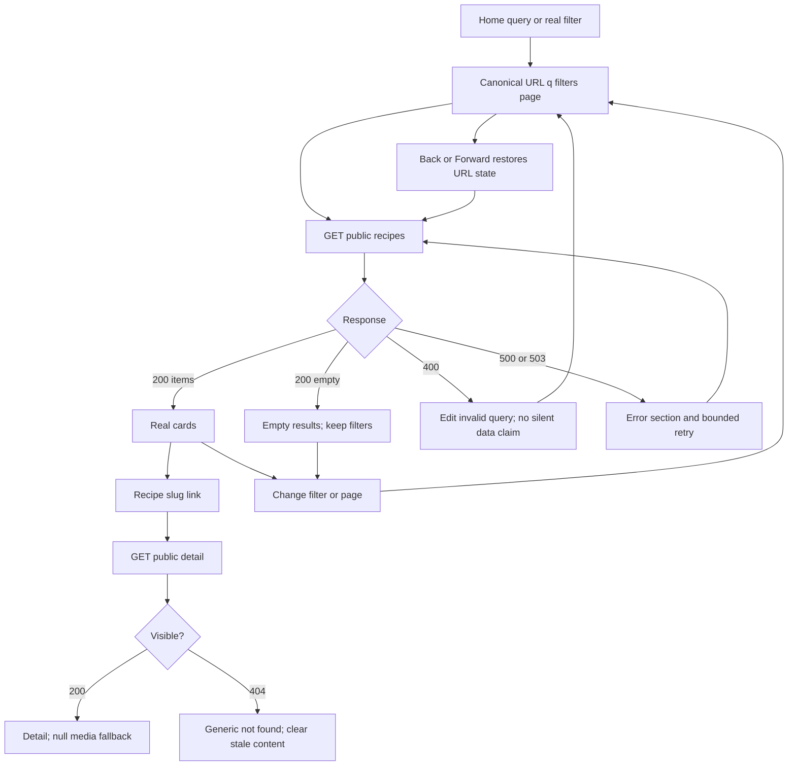
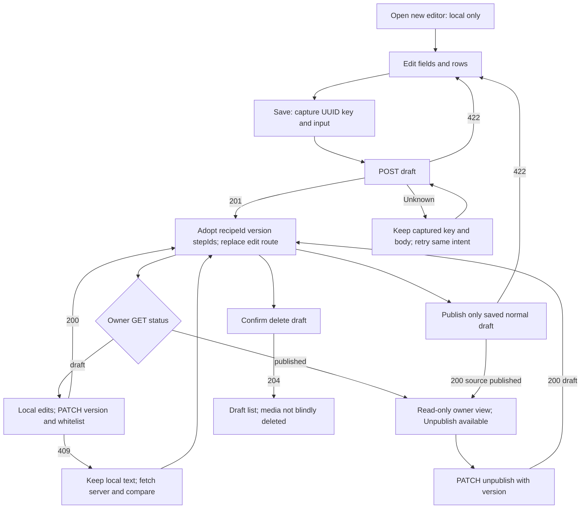
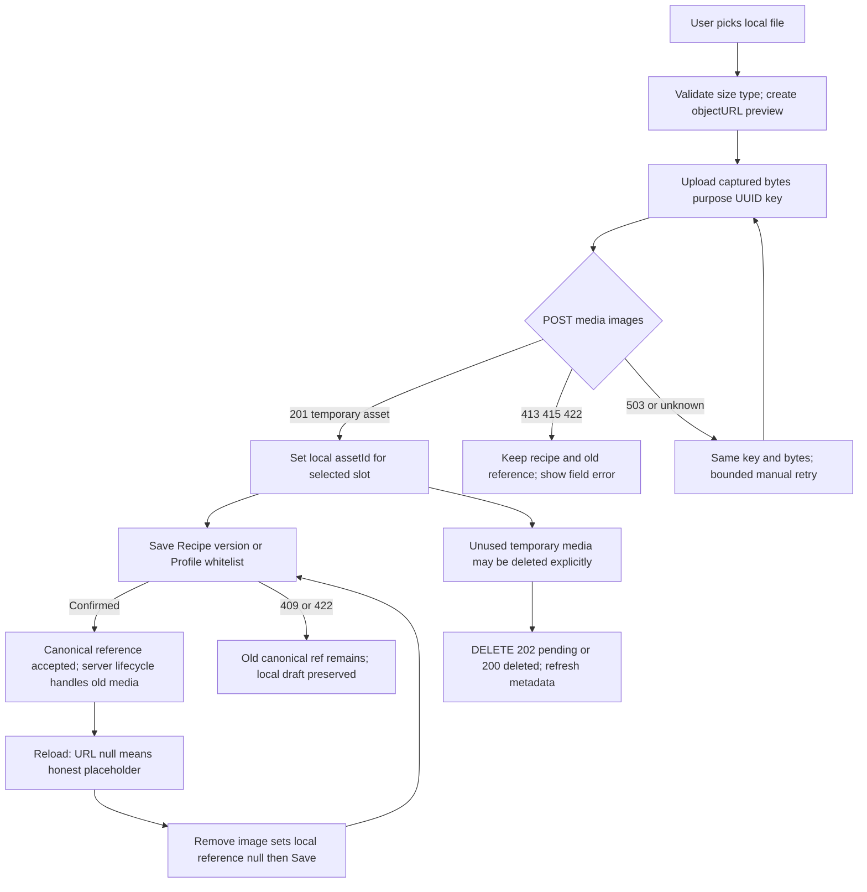
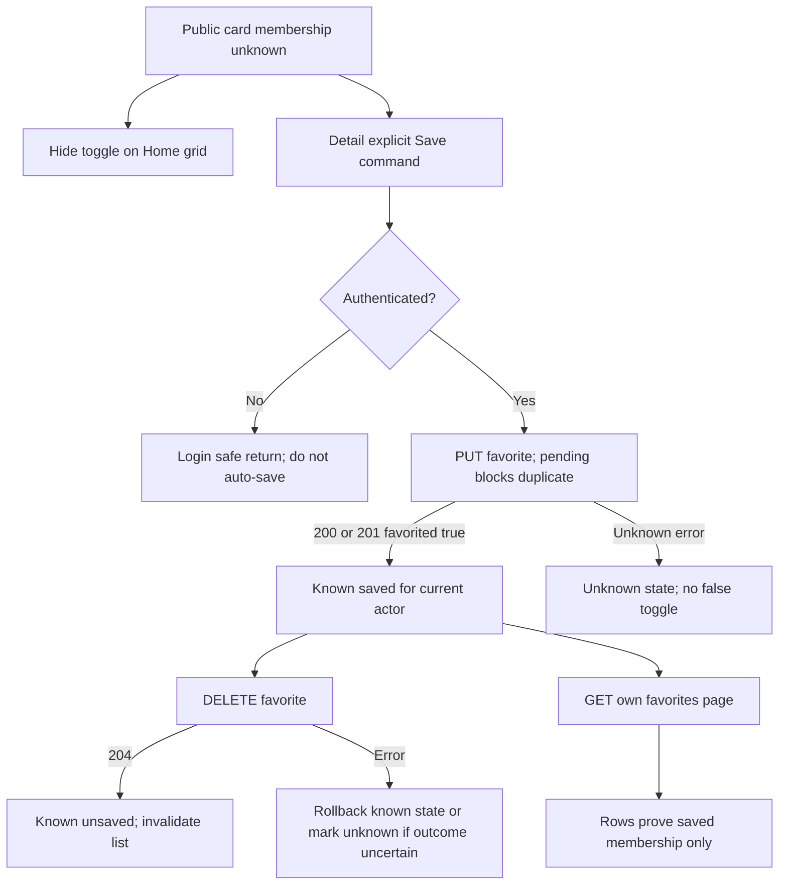
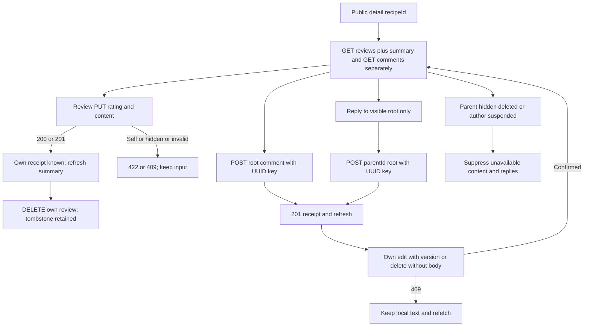
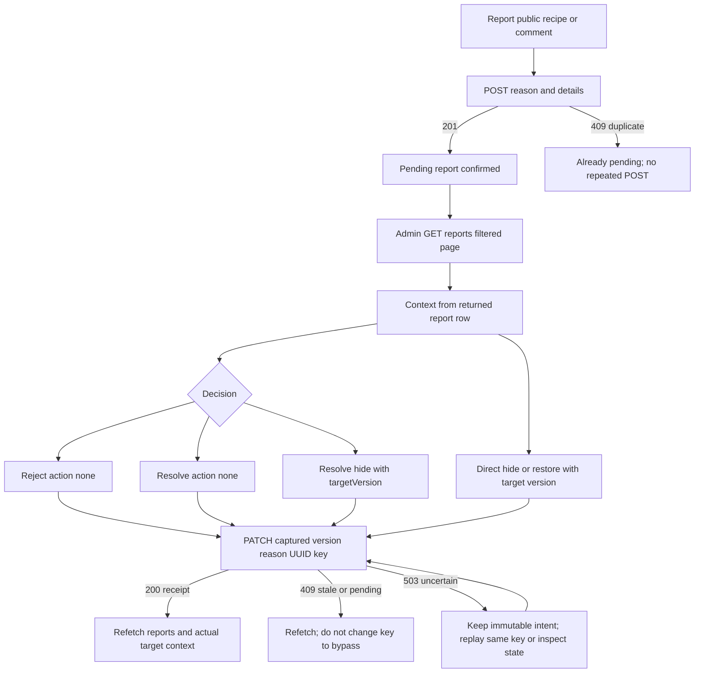
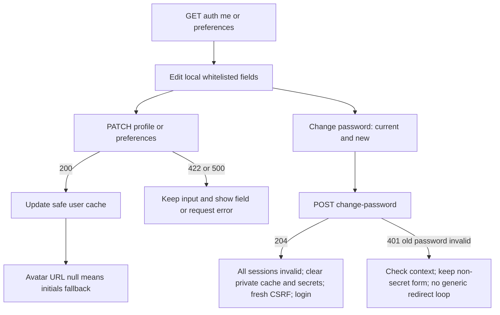
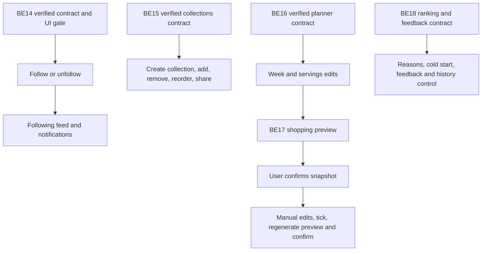

# FE-03 — Navigation and User Flows

2026-11-10 · proposed specification, chưa runtime. [Routes](FE-03-Screen-Inventory-and-Routes.md), [Actions](FE-03-Action-Registry.md), [API/G1](FE-03-API-Operation-Mapping.md), [States](FE-03-Screen-State-Matrix.md).

## Navigation architecture

Desktop≥1360 dùng SidebarWood full và rail khi có data.1025–1359 sidebar220,railstack.≤1024 MobileHeader + modalDrawer; chỉ một navigationtree có thể nhậnfocus. Logo/Home→`/`,Explore→`/recipes`; mục User/Admin chỉ khi realauth và destination đượcimplement. Chưa Auth/Editor thìẩnCreate/LoginCTAs phụthuộc, khônglinktớistubfake. Hai quickactions Explore/Create chỉ hiện khi flows tươngứng thật; không thêmP2navđểđủảnh.

Account disclosure có profile/preferences/password/media/workspace/favorites vàlogout theoavailability; Admin entry→`/admin/reports`, khôngdashboardstats. Breadcrumb chỉEditor (Công thức của tôi→editor) vàAdmin khi cần; RecipeDetail cóExplorelink nếu hữu ích, khôngbreadcrumbs giả usertitle đểfill. No second search icon/headercontrol trùnghero.

Drawer: menubuttonaria-expanded/controls;open→focusclose/firstnav→backgroundinert/bodylock→Tabtrap. ESC/outside/Close đóngnavnondirty vàreturntrigger. Chọnroute đóngdrawer sauroutecommit;resize>1024 đóng/unlock,focuscurrentnav/main nếutriggerẩn. Account ESC/outsideclose returntrigger,Tabnormal; khôngrolemenu giả. Dialogdirty/pending closure đi qua policy, khôngESC→mutation/DBcancel. Boundedpending/errorrecovery tránh modal khóa vô hạn.

## Route guard và safe return proposal

Authinitialunknown→GETauth/me;protected content khôngrender cachedprivate tronglúcunknown.401UNAUTHENTICATED→clearscopedcache→login?returnTo=validatedinternalpath.403role→inlineforbidden/page403,không đổi sangscreen khôngliênquan đểche lỗi. Publicpages vẫnreadguest,khôngredirectmọi401APIloginlỗi.

Safe return parse bằng same-origin URL parser; chỉpathallowlist của implementedroutes. Bắt đầu `/`,không`//`,backslash,controlchars,externalorigin,encodedseparator tricks hoặc authloop `/login,/register,/auth/*`; không rawdecodevôhạn. Chọn whitelistpath/query theo từngroute,dropsecretfragment/unknownkeys. Khi invalid→`/me` nếuworkspaceimplemented,else`/`. Kiểmtra lại saulogin vìrole/destinationgate cóthểkhác; không chỉtinstringtừquery. Khôngautoexecutemutation saulogin;trởvềform đểuserconfirm.

Returnpath không chứaemail/token/password/commentbody. Register201 chuyểnsuccesspanel cóLoginlink giữsafereturn đãvalidated,khôngselflogin. Login200→refreshCSRF→getCurrentUser→safe replace đểBack khôngquayvềsubmitlogin. Logout204 clearprivatecaches/keys/blob/token,refetchCSRF; đangprotected thìHome,đangpublic giữpublicroute. Login401INVALID_CREDENTIALS làformerror,khôngredirectloop. Đổi/resetpassword204 invalidateall → login,không giữownercontext cũ.

Browser Back/Forward: committedsearch/filter/page URLlànguồnstate,abort/ignorestaleGET;requestlỗi giữURL/query. Openreportdialog UIquery được allowlist riêng,không gửi Backendstrictquery. Dirtyeditor interceptrouterleave,Back vàhardreload theo khả năngbrowser;nativebeforeunloadprompttext khôngđiềukhiểnhoàn toàn. Staygiữdraft;Leave discardlocalonly sauconfirm;requestuncertain cầnreconcile,khôngclaim đãcancel.

## F1 — Guest → Login → protected action

CSRFfailure chắcchắnbịrejecttrướcwrite cóthểrefresh rồiuserretry;networkunknownlogin khôngautosubmitvôhạn. Register không nằm login-successbranch. Sensitivepassword chỉmemory,clearonconfirmed/leave,khôngpersistformacrossaccounts.

## F2 — Home → Explore → Search → Detail

qexactfoldedAND title/description;ingredientpickerGETcatalogprefix→IDsCSVany/all,không free-textingredientqclaim. Filterchange resetpage1;clearallgiữsort/limit nhưngbỏq+filters. Queryempty omit q,vìq='' khônghợp lệ. Raceđổiquery nhanh:latestURLwins,staleresponsekhôngupdatecards/count.

## F3 — Create/Edit/Publish/Unpublish/Delete

**Source hiện tại:** listMyRecipes chỉdraft, GETown cópublished, PATCH/DELETE chỉdraft. Saupublish giữreturnedrecipeId/edit route hoặcDetailownerentry đểunpublish,khônghứa tìmpublishedquaMyRecipeslist. Publishresponse/Getownpublished mâu thuẫnOwnerDTO.statusconstdraft ởOAS:integrationcontractgap cầnBackend/docfix riêng trước nghiệmthu integration,khôngtựđổiFE03.

Draftarraysfullreplacement;localsteps UUIDkey riêng đếnkhi servertrảstepId,không arrayindexidentity. NewstepomitstepId;reorder renumberorder1..N giữexistingIDs/assetrefs. Add/remove/reorder chỉlocal,không endpointperstep giả. Published muốn sửa/xóa phảiunpublish;ownerẩnmoderation khôngtựgỡhidden. Dirtyleave confirmation haihànhviStay/Leave;422giữfields,401khôngautoresubmit capturedmutation bằngactor khác,409khôngoverwrite.

## F4 — Recipe media

KhôngsetContentType manually chomultipart boundary. Uploadpurposeavatar≤2MiB,cover/step≤5MiB;JPEG/PNG/WebP;servervalidation authority. Avatarattach PATCHprofile;Recipecover/stepattach PATCHdraft (newRecipePOSTcórefnếuhợp lệ). Oldpreview/ref khôngxóa trướcsaveconfirmed;blobpreview chọnmới có thểhiện thay tạm nhưngcanonicaloldref vẫnđượcgiữ phục hồi. RevokeobjectURL khiđổi/pickdiscard/leave/accountchange. Binarygateway hiệnauthorized503,noowneravatarbinaryroute;không dựngURLđểchữaảnhhỏng.

## F5 — Favorites without false membership

Đây là refinement **proposedFE03**: Detail “Lưu yêu thích” làidempotentcommand,khôngtoggleshowunsaved;receiptmớiconfirmssaved. Khôngfetchmọifavoritepagesvôhạn,khôngcoiabsenttrang1thànhfalse. Clientrecord scopedactor+recipe,invalidates/logoutclear,không đảm bảosnapshotqua tabkhác. Muốninstantglobalknownstate cầnBackendbatchgetter riêng.

## F6 — Reviews and comments

Không GETown-reviewriêng. Nếutrangreviews hiệncóownrow thìeditfilled;chưathấykhôngclaim chưađánhgiá;userexplicitPUTfullreplacement cóthểupdateexisting. No selfreview,hiddenreview409khôngdelete/recreatebypass. Commentdelete204rootkhôngcascadeharddelete nhưngrepliessuppressed. Pendingcomment503 replayUUIDkeycũ,cùngcontent/parent;429giữdraft. Versionrootcóthểtăngkhi replynênrefetchversion trướcpatch. FieldplainText khôngchấpnhậnnewline/tab theo source,không dùng FE02generictextareaassumption đểđổicontract.

## F7 — Report and moderation

Admincontexttừlist,khôngGETreportdetail/auditlisting/allprivateRecipes. `available=false` khônghiệntextdraft/deleted;actionnonecóthểresolve targetmissing,hidecầnversionđúng. Restoretargetnormal/visiblekhôngpublish hoặcundelete;GETcontextmới mới chứngminhactualstate. Auditreceipt replaylàlịch sửcủaoperation,khôngcurrenttargetversion. Unknownwrite giữkey/reason/version;userkhác/accountkhác không tiếpquảnintent bằngAPIclient. Reportsubmissionkhôngidempotencykeycontract nênnetworkunknownkhôngblindautoPOST.

## F8 — Profile, preferences and password

Khôngeditrole/status/email từprofile. PreferencesUIchỉtrườngđãdùng thật,dietary/exclusionslàlựachọnkhôngmedicalguarantee;notificationSettings/recoOptIn cóschema nhưngẩncontrol phụthuộcfeaturechưaavailable,khôngxóagiátrịcũkhisavecácfieldkhác.

## F9 — P2 planned dependencies (không live)

TấtcảP2 `planned/blocked_backend`,ẩnnav/control,chưa operationIds/methodpayload đượccôngbố. Collectionsprivate/public visibility,mealtimezone/version,shoppingunit/checked/manualpreservation,recofallback/consent vẫn requirements trong RTM;khôngxóascopevìBackendchưacó. Assetproduction cần WorkOrder riênghoặcexplicitFE04scope,không tạoFE03.

## Responsive/accessibility interactions

| Viewports          | Navigation/forms/cards/admin                                                                                                                                                          |
| ------------------ | ------------------------------------------------------------------------------------------------------------------------------------------------------------------------------------- |
| 1672×941 /1440×900 | Sidebar244/220,rail356/300,grid4/3;keyboardlinks đúngtaborder;menu/disclosure/dialog behavior nhưFE02                                                                                 |
| 1024×768 /768×1024 | Drawer,main976/720,grid3/2;chipswrap,searchkhôngcóduplicateheadersearch;dialogwidth≤560,scrollaccessible                                                                              |
| 390×844 /360×800   | Drawer/menu44target,main358/328,grid1;searchstacknếucần,quickactions2→1khiđủwidth;forms1col                                                                                           |
| All +zoom200%      | Focusvisiblekhôngclip,dialogtrap/ESC/restore,headingroutefocus,statusannouncementngắn,reducedmotion0ms;Admin table cócaption và localhorizontalcontainer nếu quáhẹp,khôngpageoverflow |

Querytyping khôngannouncekếtquả mỗi phím,submit/refetchstatusannounce1lần. Paginationfocus vềsectionheading/sentinel hợp lý,khôngtopbody bấtngờ;errorfocusfield/summary,nodatađượcphânbiệtfailedload. Các criteria này **not_verified browser**, không testđãpass.
